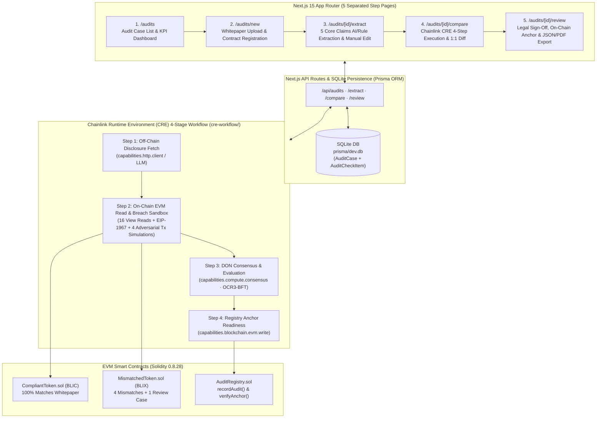

# Disclosure vs. Smart Contract Mismatch Auditor
**스마트계약·공시자료(백서) 정합성 및 불일치 점검기 (Chainlink CRE 기반 법무·컴플라이언스 증빙 플랫폼)**

> **BLI Legal Tech Hackathon 2** · **Track:** LegalTech & RegTech · **Bounty:** Chainlink CRE (*Best workflow with CRE*)

---

## 1. Executive Summary (One-Line Pitch & Problem Definition)

### English
**One-Line Pitch:**  
An end-to-end **LegalTech & RegTech evidence platform** powered by **Chainlink Runtime Environment (CRE)** that extracts tokenomics/governance claims from off-chain whitepapers, inspects live EVM smart contract states & proxy slots, flags factual discrepancies (`MATCH` / `MISMATCH` / `NEEDS_HUMAN_REVIEW`), and anchors tamper-evident SHA-256 audit digests on-chain via `AuditRegistry.sol`.

**Problem Definition (Why LegalTech & RegTech Needs This):**  
Under emerging digital asset regulations (such as **EU MiCA**, the **Korean Virtual Asset User Protection Act (가상자산이용자보호법)**, and **DAXA Listing Review Guidelines**), token issuers publish whitepapers promising investor protections—such as *"Fixed 100M max supply with minting disabled"*, *"0% transfer tax"*, *"No arbitrary wallet freeze"*, *"36-month on-chain team vesting"*, and *"Non-upgradeable immutable contract"*.  
However, in practice, legal and compliance officers lack automated tooling to verify whether the **actual deployed EVM bytecode and storage slots** honor those prose disclosures, resulting in undetected hidden `mint()` backdoors, mutable transfer taxes, `blacklist()` privileges, unlocked team treasuries, or unannounced EIP-1967 upgrade proxies.

### 국문 요약 (Korean Summary)
- **한 줄 소개:** 가상자산 백서(공시자료)의 5대 핵심 약속(Claim)과 온체인 스마트계약의 실제 코드·스토리지 상태(On-chain Fact)를 **Chainlink CRE 4단계 워크플로**로 1:1 대조하고, 법무·컴플라이언스 담당자의 최종 검토 의견을 거쳐 **SHA-256 증빙 해시만 온체인(`AuditRegistry.sol`)에 앵커링**하는 증빙 도구입니다.
- **핵심 원칙 (Non-Legal-Advice):** 본 시스템은 위법 여부를 자동 판정하거나 법률 자문을 제공하는 도구가 아니며, 공시 주장과 온체인 사실 간의 **객관적 불일치 증빙(Evidence Package)**을 생성해 변호사·컴플라이언스 심사역의 검토를 돕는 의사결정 지원 시스템입니다.

---

## 2. System Architecture (Multi-Page App Router + SQLite + Chainlink CRE + Solidity)

### Mermaid Architecture Diagram



### ASCII Architecture Overview

```text
+---------------------------------------------------------------------------------------------------+
|                        Next.js 15 Multi-Page App Router (No Single-Page Tabs)                     |
|  [/audits] ---> [/audits/new] ---> [/audits/[id]/extract] ---> [/audits/[id]/compare] ---> [/review]
+-------------------------------------------------+-------------------------------------------------+
                                                  | REST API (/api/audits/...)
                                                  v
+---------------------------------------------------------------------------------------------------+
|                   SQLite Persistent Storage (prisma/dev.db via Prisma ORM)                        |
|  - AuditCase: documentHash (SHA-256), tokenAddress, chainId, onchainSnapshotJson, reportHash      |
|  - AuditCheckItem (5 Core Items): disclosedClaim, sourceQuote, onchainState, status, reviewerNote |
+-------------------------------------------------+-------------------------------------------------+
                                                  | Orchestrated by
                                                  v
+---------------------------------------------------------------------------------------------------+
|                 Chainlink CRE 4-Stage Workflow (cre-workflow/workflow.yaml & src/index.ts)        |
|  [Step 1] Off-chain Whitepaper Claim & SHA-256 Fetch (HTTP / Structured LLM / Rule Parser)        |
|  [Step 2] EVM Read (16 Views + EIP-1967) + 4 Counterfactual Breach Simulations (Cloned EVM State) |
|  [Step 3] DON OCR3-BFT Consensus (4/4 nodes, quorum >= 3): 1:1 Claim vs Fact & reportHash         |
|  [Step 4] On-Chain AuditRegistry.recordAudit() Calldata & verifyAnchor() Integrity Verification   |
+-------------------------------------------------+-------------------------------------------------+
                                                  | ABI eth_call & eth_sendTransaction
                                                  v
+-------------------------------+  +-------------------------------+  +-----------------------------+
| CompliantToken.sol (BLIC)     |  | MismatchedToken.sol (BLIX)    |  | AuditRegistry.sol           |
| 0x534c51921913a8717Ca2db55... |  | 0xbbE3c849D90c63645F917Be8... |  | 0x5B0547C68bc608E6A9b94C... |
+-------------------------------+  +-------------------------------+  +-----------------------------+
```

### Live Ethereum Sepolia Testnet Contracts (`chainId: 11155111`)
- **`CompliantToken.sol (BLIC)`:** [`0x534c51921913a8717Ca2db550b77fFabf168f71e`](https://sepolia.etherscan.io/address/0x534c51921913a8717Ca2db550b77fFabf168f71e)
- **`MismatchedToken.sol (BLIX)`:** [`0xbbE3c849D90c63645F917Be84a5b454FE858186F`](https://sepolia.etherscan.io/address/0xbbE3c849D90c63645F917Be84a5b454FE858186F)
- **`AuditRegistry.sol`:** [`0x5B0547C68bc608E6A9b94C515B5B66215981856c`](https://sepolia.etherscan.io/address/0x5B0547C68bc608E6A9b94C515B5B66215981856c)
- **Sample On-Chain Anchor Tx (`recordAudit`):** [`0x36850fc9853adf71484870098cec806002a786b1a61d26536bda8175a12fb788`](https://sepolia.etherscan.io/tx/0x36850fc9853adf71484870098cec806002a786b1a61d26536bda8175a12fb788)

---

## 3. Five Mandatory Disclosure vs. On-Chain Check Items & Demo Results (`BLIC` vs. `BLIX`)

Every audit case evaluates **5 core regulatory disclosure dimensions** by comparing the extracted whitepaper claim against live EVM contract calls and storage slots:

| # | Item Key (`AuditCheckItemKey`) | Inspection Scope (Whitepaper vs. Smart Contract) | On-Chain Evidence Functions & Storage Slots | Case A: `BLIC` (`CompliantToken.sol`) | Case B: `BLIX` (`MismatchedToken.sol`) |
| :-: | :--- | :--- | :--- | :--- | :--- |
| **1** | `maxSupplyAndMintability` | **Max Supply Cap & Additional Minting Privilege**<br/>(최대 발행량 및 추가 발행 권한) | `totalSupply()`, `MAX_SUPPLY()`, `maxSupply()`, `mintable()`, `owner()` | **`MATCH`**<br/>100M fixed cap, `mintable=false`, `owner=0x0` (renounced) | **`MISMATCH` (HIGH)**<br/>Whitepaper claims 100M fixed cap & no minting, but `mintable=true` & `MAX_SUPPLY=uint256.max` (unlimited) |
| **2** | `transferFee` | **Transfer Tax / Fee Rate & Mutability**<br/>(전송 수수료율 및 임의 변경 권한) | `transferFeeBps()`, `maxTransferFeeBps()`, `feeMutable()` | **`MATCH`**<br/>`transferFeeBps=100` (1.00% fixed as disclosed), `feeMutable=false` | **`MISMATCH` (HIGH)**<br/>Whitepaper claims 1.00% (100 bps) fixed fee, but `transferFeeBps=500` (**5.00%**) & `feeMutable=true` (up to 100%) |
| **3** | `transferRestrictions` | **Pause & Wallet Blacklist/Freeze Privileges**<br/>(전송 일시정지 및 블랙리스트 동결 권한) | `paused()`, `pausable()`, `blacklistable()`, `owner()` | **`MATCH`**<br/>`pausable=false`, `blacklistable=false` | **`MISMATCH` (HIGH)**<br/>Whitepaper claims unrestricted transfers, but `pausable=true` & `blacklistable=true` |
| **4** | `teamLockup` | **Team/Advisor Token Lockup & Vesting Enforcement**<br/>(팀 물량 락업 및 온체인 베스팅 강제 여부) | `teamWallet()`, `teamAllocation()`, `teamLockupActive()`, `teamLockupReleaseTimestamp()` | **`MATCH`**<br/>`teamLockupActive=true`, locked until `1830297600` (`2028-01-01 UTC`) | **`MISMATCH` (HIGH)**<br/>Whitepaper claims on-chain lockup until `2028-01-01`, but `teamLockupActive=false` & `releaseTimestamp=0` |
| **5** | `upgradeability` | **Proxy Upgradeability & Logic Replacement Privilege**<br/>(프록시 업그레이드 및 컨트랙트 로직 변경 권한) | `upgradeable()`, `logicImplementation()`, `adminAddress()`, EIP-1967 Slot (`0x360894...bbc`) | **`MATCH`**<br/>`upgradeable=false`, `adminAddress=0x0`, EIP-1967 slot empty | **`NEEDS_HUMAN_REVIEW` (MEDIUM)**<br/>Whitepaper claims immutable contract, but `upgradeable=true` with single-EOA `adminAddress` & active EIP-1967 slot (requires governance timelock review) |

---

## 3.5. Differentiating LegalTech & RegTech Capabilities

### A. Adversarial On-Chain Breach Simulation (`Counterfactual Breach Simulator`)
Beyond passive `view` reads, our CRE Step 2 engine clones the target contract's EVM state (`@ethereumjs/evm` `runCall` with state checkpoints) and executes **4 adversarial whitepaper-breach transactions** to provide courtroom-grade proof of whether the bytecode blocks or permits issuer misconduct:

| Scenario | Attempted Breach Transaction (`evm.runCall`) | `BLIC` (`CompliantToken.sol`) | `BLIX` (`MismatchedToken.sol`) |
| :--- | :--- | :--- | :--- |
| **1. Unauthorized Minting**<br/>(무단 추가 발행 시도) | Admin calls `mint(attacker, 10,000,000 * 10^18)` | **`DEFENDED / BLOCKED_BY_CODE`**<br/>Reverts immediately (selector `0x40c10f19` absent) | **`BREACH_SUCCEEDED`**<br/>`totalSupply` inflates from `100,000,000` → `110,000,000 BLIX` (Gas: `26,427`) |
| **2. Predatory 50% Fee Hike**<br/>(수수료 기습 50% 인상 시도) | Admin calls `setTransferFeeBps(5000)` | **`DEFENDED / BLOCKED_BY_CODE`**<br/>Reverts immediately (constant 100 bps) | **`BREACH_SUCCEEDED`**<br/>`transferFeeBps` jumps from `500 bps` → `5,000 bps` (**50.00% tax**, Gas: `1,983`) |
| **3. Investor Wallet Freeze**<br/>(투자자 지갑 강제 동결 시도) | Admin calls `setBlacklisted(investor, true)` → Investor calls `transfer(1,000)` | **`DEFENDED / BLOCKED_BY_CODE`**<br/>Blacklist call reverts; investor transfer succeeds | **`BREACH_SUCCEEDED`**<br/>Investor is frozen (`isBlacklisted=true`) and subsequent `transfer()` reverts with `AddressBlacklisted` |
| **4. Premature Team Token Dump**<br/>(팀 락업 물량 조기 유출 시도) | `teamWallet` calls `transfer(recipient, 5,000,000 * 10^18)` prior to `2028-01-01` | **`DEFENDED / BLOCKED_BY_CODE`**<br/>Reverts with custom error `TeamTokensLockedUntilRelease(1830297600, 1760419000)` | **`BREACH_SUCCEEDED`**<br/>5,000,000 `BLIX` immediately exits `teamWallet` before the disclosed unlock date (Gas: `52,189`) |

### B. Multi-Jurisdiction Legal Mapping (KR / EU / US), Automated Legal Cure Notice & Solidity Remediation Diff
On `/audits/[id]/compare` and `/audits/[id]/review`, each finding is mapped to **3 major regulatory jurisdictions** and paired with an actionable **Legal Cure Notice (소명 및 시정요구서 초안)** and **Solidity Code Remediation Diff**:
- **🇰🇷 South Korea:** 「가상자산 이용자 보호 등에 관한 법률」 제10조 제4항 제2호 (중요사항 거짓 기재·누락 금지) & DAXA 거래지원 심사 공통 가이드라인
- **🇪🇺 European Union:** Regulation (EU) 2023/1114 (**MiCA**) Article 6 (Fair, Clear, Not Misleading Whitepaper) & Article 15 (Civil Liability for Misleading Whitepaper Disclosures)
- **🇺🇸 United States:** SEC Division of Corporation Finance — Digital Asset & Smart Contract Disclosure Guidance (Supply Mechanics, Mutable Tax, Transfer Restrictions, Insider Vesting, Governance Centralization)
- **Automated Dual-Track Remediation (`/audits/[id]/review`):** Generates (1) a formal **Legal Cure & Explanation Demand Notice** ready for one-click copy/PDF export, (2) a side-by-side **Solidity Code Remediation Diff** (`- MismatchedToken.sol` vs `+ CompliantToken.sol`), and (3) **Whitepaper Redline Options A & B**.

### C. Zero-Hallucination Neuro-Symbolic Guardrail (`Gemini + Deterministic EVM & Source Verifier`)
In LegalTech and RegTech workflows, unverified LLM outputs risk inventing whitepaper quotes, altering empirical on-chain numbers, or citing fabricated statutes. We eliminate LLM hallucination across Step 1 (`/extract`), Step 2 (`/compare`), and Step 3 (`/review`) by pairing **Google Gemini API (`GEMINI_MODEL="gemini-3.8-flash"`, fallback `gemini-2.5-flash` / `gemini-2.0-flash`, `temperature: 0`, strict JSON Schema)** with a **4-Layer Post-LLM Deterministic Verification Engine (`src/lib/hallucination-guard.ts`)**:

1. **Guard 1 — Exact Source Quote Grounding (`quoteGrounded: true`):**
   Every `sourceQuote` extracted or cited by Gemini is verified against the raw `whitepaperText` via normalized substring matching. If an LLM paraphrases or fabricates a quote, the engine automatically restores the exact verbatim sentence from the deterministic parser and logs the auto-remediation.
2. **Guard 2 — Numerical & On-Chain Fact Lock (`factsLocked: true`):**
   Core comparison verdicts (`MATCH` / `MISMATCH` / `NEEDS_HUMAN_REVIEW`), empirical EVM return values (`100,000,000`, `100 bps`, `500 bps`, `1830297600`, `0x534c5192...`, `0xbbE3c849...`), and counterfactual breach outcomes (`DEFENDED` / `BREACH_SUCCEEDED`) are computed strictly by the deterministic EVM & rule-parser engine. Gemini is restricted to synthesizing legal explanations around locked empirical facts and cannot mutate any verdict or numerical evidence.
3. **Guard 3 — Closed-World Statute Whitelist (`statutesWhitelisted: true`):**
   Legal rationales and Cure Notices are checked against a closed-world statutory registry (`src/lib/legal-knowledge.ts`: KR VAUPA Art. 10(4)(2), DAXA Listing Guidelines, EU MiCA Art. 6 & 15, US SEC CorpFin Guidance / Rule 10b-5). Any unverified statutory article citation outside the whitelist is stripped and replaced with the canonical statutory reference.
4. **Guard 4 — Human-in-the-Loop Sign-off Gate (`signoffStatus: "AI_DRAFT_VERIFIED"`):**
   All Gemini-synthesized legal opinions and Cure Notices are tagged `AI_DRAFT_VERIFIED` alongside the badge **`Hallucination Guardrail: PASSED (Quote Grounded ✓ · EVM Facts Locked ✓ · Statutes Whitelisted ✓)`**, requiring explicit human Legal Counsel review and sign-off before `AuditRegistry.sol` on-chain anchoring is unlocked.

---

## 4. 1-Minute Quickstart & Reproducibility Guide (For Judges)

All commands work out-of-the-box in a local environment without requiring external paid API keys or an external Ethereum node (includes an embedded real EVM bytecode execution engine via `@ethereumjs/evm` + `viem` ABI encoding, while seamlessly connecting to Sepolia/Anvil if `RPC_URL` is configured).

```bash
# 1. Install dependencies
npm install

# 2. Compile & deploy the 3 Solidity contracts (CompliantToken, MismatchedToken, AuditRegistry)
npm run contracts:deploy

# 3. Initialize & seed SQLite database (prisma/dev.db) with BLIC & BLIX cases
npm run db:seed

# 4. Run Chainlink CRE 4-Stage Workflow CLI Simulation (Bounty Verification)
npm run cre:simulate

# 5. Run End-to-End Verification across all 5 Multi-Page Routes & APIs
npm run test:e2e

# 6. Start the Next.js Web Application (http://localhost:3300 -> redirects to /audits)
npm run dev
```

### Multi-Page URL Routes to Explore in Browser
- **`http://localhost:3300/audits`** — Saved audit case repository (`BLIC` & `BLIX` pre-loaded from SQLite)
- **`http://localhost:3300/audits/new`** — Register a new whitepaper (`.md`/`.txt` or 1-click sample loader) & smart contract address
- **`http://localhost:3300/audits/audit-mismatched-blix/extract`** — Inspect raw whitepaper & edit extracted 5 core claims
- **`http://localhost:3300/audits/audit-mismatched-blix/compare`** — Run Chainlink CRE 4-step workflow, inspect DON consensus digest, view 4 Counterfactual Breach Simulations, and inspect 1:1 claim vs. on-chain state diff with KR/EU/US statutes
- **`http://localhost:3300/audits/audit-mismatched-blix/review`** — Review automated Legal Cure Notice & Solidity Remediation Diff, enter legal counsel notes, execute on-chain `AuditRegistry.recordAudit()`, verify `verifyAnchor() === true`, and export JSON/PDF evidence package

---

## 5. Compliance, Privacy & Non-Legal-Advice Principles

1. **Strict Non-Legal-Advice Positioning:**  
   This platform does **not** issue automated legal opinions or adjudicate statutory illegality. Instead, it flags factual alignments (`MATCH`), factual contradictions (`MISMATCH`), and cases requiring off-chain evidentiary corroboration (`NEEDS_HUMAN_REVIEW`) so that qualified legal and compliance officers can make informed decisions.
2. **Data Minimization & Zero On-Chain PII / Raw Text Storage:**  
   Full whitepaper documents, internal compliance notes, and reviewer names are stored **exclusively off-chain in SQLite (`prisma/dev.db`)**. Only deterministic 32-byte SHA-256 digests (`documentHash` and `reportHash`), contract metadata (`tokenAddress`, `chainId`, `blockNumber`), and `mismatchCount` are anchored on-chain in `AuditRegistry.sol`, ensuring full compliance with data privacy regulations (GDPR / PIPA).
3. **Cryptographic Reproducibility:**  
   Any regulator, exchange listing committee, or external auditor can independently recompute the SHA-256 hash of the whitepaper and the JSON evidence report and call `AuditRegistry.verifyAnchor(anchorId, documentHash, reportHash)` on-chain to confirm `verified === true`.
